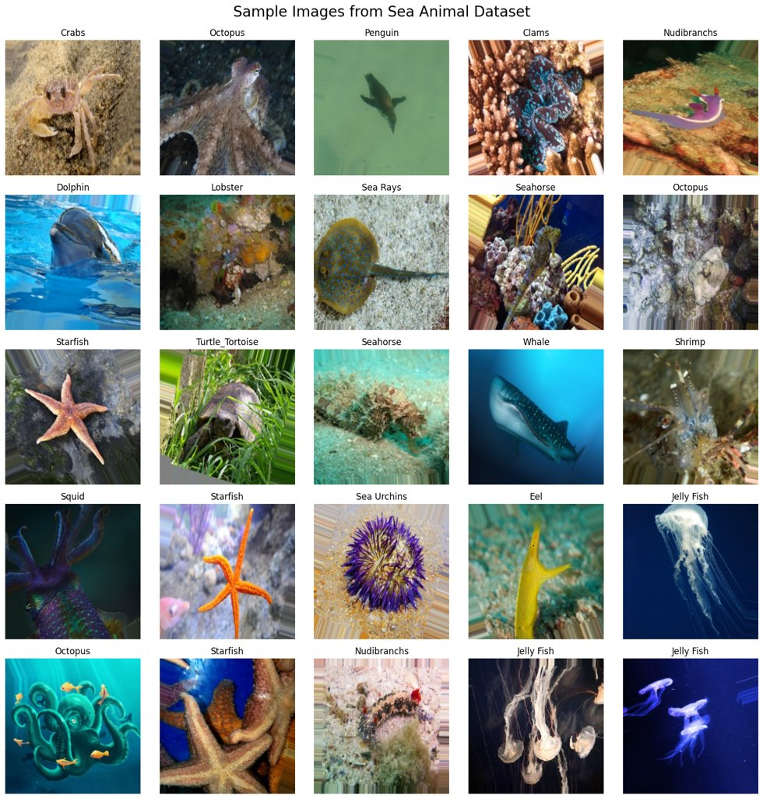
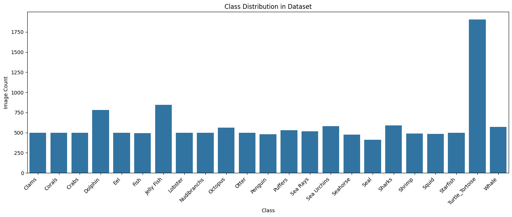
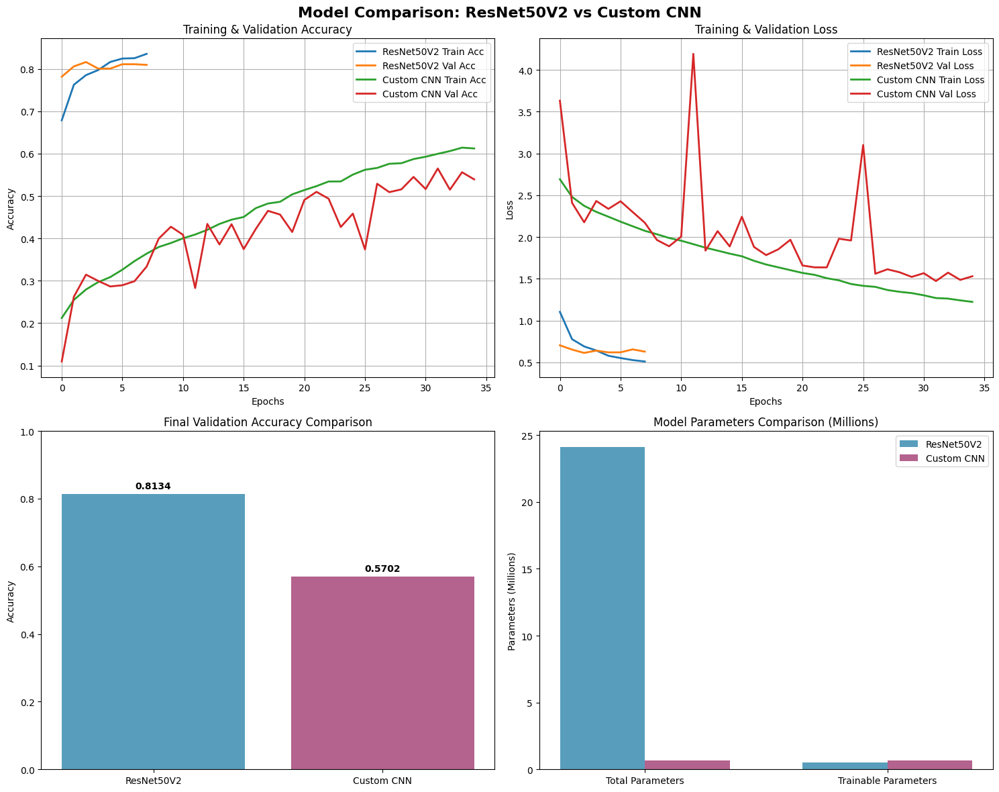
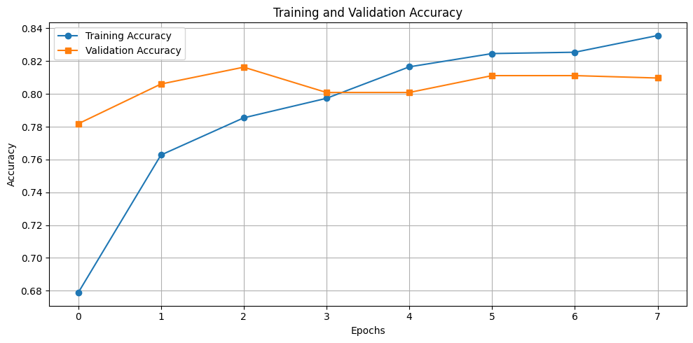
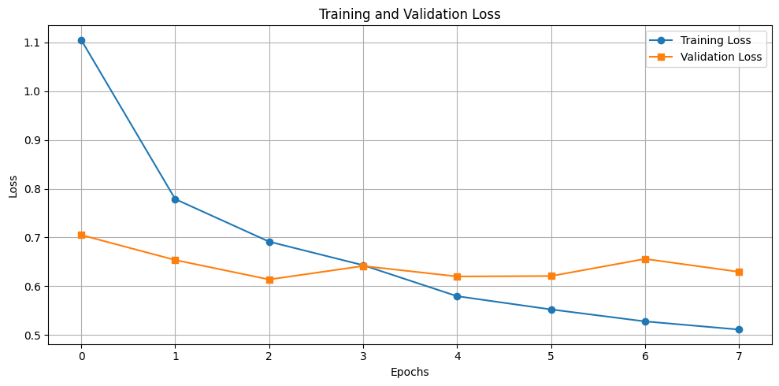
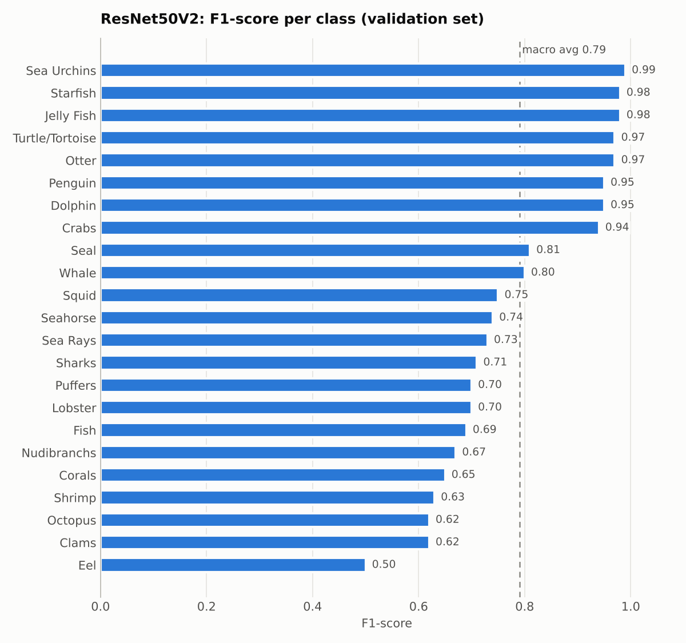
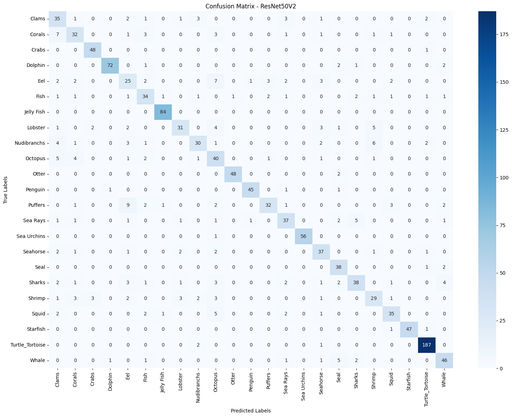

# 🐠 Sea Animals Image Classification: ResNet50V2 vs Custom CNN

A deep learning project that classifies images of **23 sea animal species** and compares **transfer learning with ResNet50V2** against a **custom CNN built from scratch**.

---

## 📌 Overview

Identifying marine species from images supports biodiversity monitoring, underwater research, aquarium management, and educational tools. With many visually similar species (such as squid and octopus, or seals and otters), this is a challenging fine-grained classification problem.

This project builds two image classifiers on the **Sea Animals Image Dataset** and compares them:

1. **ResNet50V2 with transfer learning:** an ImageNet pre-trained network used as a feature extractor, with a new classification head.
2. **Custom CNN:** a four-block convolutional network designed and trained from scratch.

The goal is to measure how much pre-trained knowledge helps on a real multi-class image task, and what each approach costs in parameters and training.

---

## 🎯 Objectives

- Build an end-to-end image classification pipeline for 23 marine species.
- Apply **transfer learning** with ResNet50V2 pre-trained on ImageNet.
- Design and train a **custom CNN** as a from-scratch baseline.
- Compare both models on accuracy, loss, per-class performance, and model size.

---

## 📂 Dataset

**[Sea Animals Image Dataset](https://www.kaggle.com/datasets/vencerlanz09/sea-animals-image-dataste)** (Kaggle)

| Property | Value |
|---|---|
| Total images | 13,711 |
| Classes | 23 |
| Training set | 12,350 images (90%) |
| Validation set | 1,361 images (10%) |
| Input size | 256 × 256 × 3 |

**Classes:** Clams, Corals, Crabs, Dolphin, Eel, Fish, Jelly Fish, Lobster, Nudibranchs, Octopus, Otter, Penguin, Puffers, Sea Rays, Sea Urchins, Seahorse, Seal, Sharks, Shrimp, Squid, Starfish, Turtle/Tortoise, Whale

<p align="center">
  
</p>

<p align="center">
  
</p>

Most classes contain around 500 images, while Turtle/Tortoise, Jelly Fish, and Dolphin have more.

---

## ⚙️ Methodology

### Data preprocessing and augmentation

- Images resized to **256 × 256** and pixel values rescaled to **[0, 1]**
- Augmentation: **rotation (±25°)**, **horizontal flip**, and **zoom (20%)**
- 90/10 train-validation split with `ImageDataGenerator`, batch size 32

### Model 1: ResNet50V2 (transfer learning)

```
ResNet50V2 (ImageNet weights, frozen)
   → GlobalAveragePooling2D
   → Dense(256, ReLU) → Dropout(0.3)
   → Dense(23, Softmax)
```

- The pre-trained backbone acts as a **frozen feature extractor**; only the new head is trained.
- **24.1M total parameters**, of which only **530K are trainable**.

### Model 2: Custom CNN (from scratch)

```
[Conv2D → BatchNorm → MaxPool] × 4   (32 → 64 → 128 → 256 filters)
   → GlobalAveragePooling2D
   → Dense(512, ReLU) → Dropout(0.5)
   → Dense(256, ReLU) → Dropout
   → Dense(23, Softmax)
```

- **659K parameters**, all trained from random initialisation.

### Training setup

| Setting | Value |
|---|---|
| Optimizer | Adam |
| Loss | Sparse categorical cross-entropy |
| Max epochs | 35 |
| Callbacks | EarlyStopping (patience 5, restore best weights), ModelCheckpoint |

---

## 📊 Results

### Model comparison

| Model | Validation accuracy | Validation loss | Total parameters | Trainable parameters |
|---|---|---|---|---|
| **ResNet50V2 (transfer learning)** | **81.3%** | **0.62** | 24.1M | 0.53M |
| Custom CNN | 57.0% | 1.47 | 0.66M | 0.66M |

<p align="center">
  
</p>

### ResNet50V2 training curves

<p align="center">
  
  
</p>

ResNet50V2 reached about **78% validation accuracy after the first epoch** and converged within 8 epochs, when early stopping restored the best weights.

### Per-class performance (ResNet50V2)

<p align="center">
  
</p>

| Metric | Precision | Recall | F1-score |
|---|---|---|---|
| Macro average | 0.79 | 0.79 | 0.79 |
| Weighted average | 0.82 | 0.81 | 0.81 |

### Confusion matrix (ResNet50V2)

<p align="center">
  
</p>

---

## 💡 Key Insights

- **Transfer learning outperformed training from scratch by 24 percentage points** (81.3% vs 57.0%) while training fewer parameters (530K vs 659K). Features learned on ImageNet transfer well to marine images.
- **ResNet50V2 converged far faster.** It passed 78% validation accuracy in its first epoch, while the custom CNN needed all 35 epochs to reach 57%.
- **Distinctive species are recognised almost perfectly.** Sea Urchins (0.99 F1), Starfish (0.98), Jelly Fish (0.98), Otter (0.97), and Turtle/Tortoise (0.97) have unique shapes, textures, or colours.
- **Visually similar species are the hardest.** Eel (0.50), Clams, Octopus (0.62), and Shrimp (0.63) are most often confused with neighbouring classes, which shows the fine-grained nature of the task.

---

## 🚀 Future Enhancements

- **Fine-tune** the top ResNet50V2 layers with a low learning rate to adapt features to underwater imagery.
- Try newer architectures such as **EfficientNet** or **Vision Transformers**.
- Use stronger augmentation (colour jitter, cutout, mixup) for the weaker classes.
- Add a held-out **test set** and deploy the model as a web app for real-time species identification.

---

## 🛠️ Tech Stack

**Language:** Python  
**Deep learning:** TensorFlow / Keras (ResNet50V2, CNN)  
**Data & evaluation:** NumPy, pandas, scikit-learn  
**Visualisation:** Matplotlib, Seaborn  
**Dataset access:** KaggleHub

---

## 📁 Project Structure

```
sea-animals-classification-resnet50v2/
├── notebooks/
│   └── sea_animals_classification.ipynb   # data loading, training, evaluation, comparison
├── images/                                # figures used in this README
├── requirements.txt
└── README.md
```

## ▶️ How to Run

```bash
git clone https://github.com/Muniba-Manaal/sea-animals-classification-resnet50v2.git
cd sea-animals-classification-resnet50v2
pip install -r requirements.txt
jupyter notebook notebooks/sea_animals_classification.ipynb
```

The notebook downloads the dataset automatically with `kagglehub` (a Kaggle account is required). A GPU, for example in Google Colab, is recommended for training.

---

## 👥 Authors

- **Muniba Manaal**: [GitHub](https://github.com/Muniba-Manaal) · [LinkedIn](https://www.linkedin.com/in/muneebamanaal/) · [Portfolio](https://munibamanaal.github.io/portfolio/)
- **Muhammad Usama Umer**

Developed as the final project for the *Artificial Neural Networks* course, BS Artificial Intelligence, COMSATS University Islamabad.
